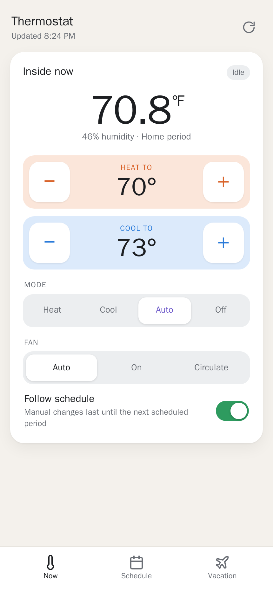
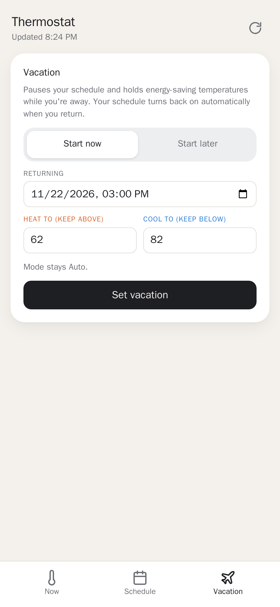

# Smart Thermostat Dashboard

A fast, ad-free web page for controlling an Amazon Smart Thermostat from any browser on your home network.

## Why this exists

I built this because controlling the thermostat through the Alexa app was painful. The app is clunky and slow, it pushes ads and "suggestions" at you, and changing a setpoint or editing the schedule means digging through a maze of screens.

This dashboard puts everything on one clean page: the current temperature, setpoints, mode, fan, the weekly schedule and a vacation hold. It installs on your phone's home screen like an app.

## Screenshots

| Now | Schedule | Vacation |
|:---:|:---:|:---:|
| <picture><source media="(prefers-color-scheme: dark)" srcset="docs/screenshots/now-dark.png"></picture> | <picture><source media="(prefers-color-scheme: dark)" srcset="docs/screenshots/schedule-dark.png"></picture> | <picture><source media="(prefers-color-scheme: dark)" srcset="docs/screenshots/vacation-dark.png"></picture> |

Light and dark themes follow your device setting.

## Compatible thermostats

| Thermostat | Status |
|---|---|
| **Amazon Smart Thermostat** (made with Honeywell Home / Resideo) | ✅ Tested. Every feature works. |

The Amazon Smart Thermostat is the only thermostat Amazon makes, and it's the one this was built and tested with.

**Other Alexa-connected thermostats** (ecobee, Honeywell Home, Google Nest, Emerson Sensi and similar) are untested. The app finds any thermostat linked to your Alexa account, so the basics may work: reading the temperature and changing setpoints and mode. The weekly schedule and fan controls use Amazon-specific features and probably won't. If you try another model, please open an issue and say how it went.

**Region:** this currently only supports US Amazon accounts (amazon.com).

## Features

- **Now:** current temperature and humidity, heat-to/cool-to setpoints, mode (Heat/Cool/Auto/Off), fan (Auto/On/Circulate), schedule on/off, and whether it's heating or cooling.
- **Schedule:** a weekly schedule editor (add or remove entries, copy one day to others), plus Home/Sleep/Away "preferred temperatures" that update every matching schedule entry at once.
- **Vacation:** pauses the schedule, holds the temperatures you pick, and turns the schedule back on at your return time. It survives restarts.
- Installs to your phone's home screen (PWA).

## How it works

The Amazon Smart Thermostat has no local API, so this app talks to Amazon's Alexa cloud, the same way the Alexa app does. It uses the unofficial [`alexa-remote2`](https://github.com/Apollon77/alexa-remote) library. Your data only goes to Amazon, never to any third party.

Since the API is unofficial, Amazon could change it at any time and break things.

## Setup

You need Docker with Docker Compose, running on a machine on your home network (a home server, Raspberry Pi, NAS and so on).

```bash
git clone https://github.com/tthom289/smart-thermostat-dashboard.git
cd smart-thermostat-dashboard
cp .env.example .env        # set HOST_IP to this machine's LAN IP
mkdir -m 700 data           # holds your Amazon session
docker compose up -d --build
```

> The container runs as user ID 1000. If your user ID isn't 1000 (check with `id -u`), run `sudo chown 1000:1000 data`.

**Link your Amazon account:**

1. Open `http://<HOST_IP>:8890`. It shows a link to the sign-in page.
2. Sign in to Amazon at `http://<HOST_IP>:3001`. This is Amazon's real login page, passed through the app.
3. You're done. The session is saved to `data/alexa-cookie.json` and refreshes itself every few days.

To sign in again from scratch, delete `data/alexa-cookie.json` and run `docker compose restart`.

## Configuration (`.env`)

| Variable | Default | Purpose |
|---|---|---|
| `HOST_IP` | *(required)* | The LAN IP you open the page with. Also used for the sign-in link. |
| `EXTRA_ALLOWED_HOSTS` | *(empty)* | Other hostnames or IPs you'll open the page with, comma-separated (e.g. a hostname or a Tailscale IP). |
| `POLL_SECONDS` | `60` | How often to fetch the thermostat's state from Amazon. |
| `DEBUG` | `0` | Set to `1` to log raw Amazon responses. These logs contain account and device identifiers. |

## Security

- **This is for your home network only. Never port-forward 8890 or 3001.** The page has no login of its own, so anyone who can reach it can change your temperature. For remote access, use a VPN such as Tailscale or WireGuard and add its address to `EXTRA_ALLOWED_HOSTS`.
- **`data/alexa-cookie.json` is an Amazon login.** Keep it private and never commit it (it's already in `.gitignore`).
- The container is locked down: read-only filesystem, all Linux capabilities dropped, `no-new-privileges`, and a 256 MB memory limit.
- A Host-header allow-list blocks DNS-rebinding attacks. Changes require a custom header and a JSON body, which blocks cross-site request forgery from other websites.

## Disclaimer

This is an independent project. It isn't affiliated with, endorsed by or supported by Amazon. "Amazon", "Alexa" and "Amazon Smart Thermostat" are trademarks of Amazon.com, Inc. or its affiliates.
